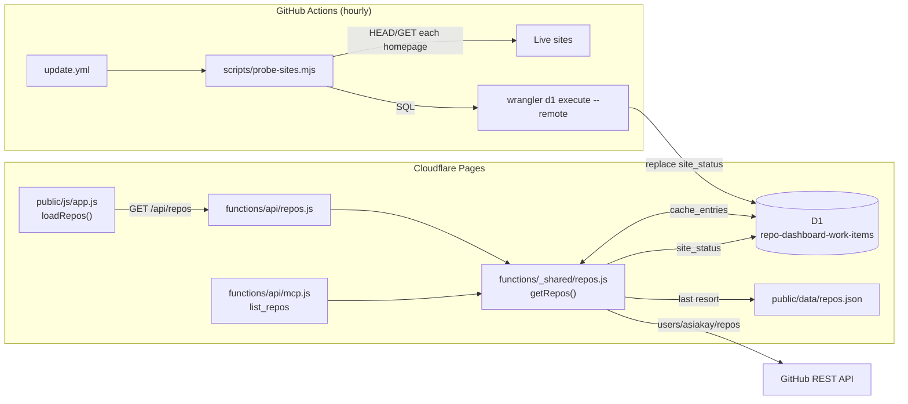

# Architecture

This document covers the **repo health data path**: how the dashboard's Repos
tab and the MCP `list_repos` tool get their data, how it stays fresh, and what
happens when any piece of it fails. Work items, OKRs and the MCP task tools are
described in `CLAUDE.md`.

## Overview



There is exactly one implementation of "get the repo list": `getRepos()` in
`functions/_shared/repos.js`. The frontend and the MCP tool both go through it,
so they can never disagree.

## Resolution order

`getRepos(env, requestUrl)` never throws. It returns the first of:

| # | Source | Condition | Result |
|---|--------|-----------|--------|
| 1 | D1 `cache_entries` | entry younger than 5 min | served as-is |
| 2 | GitHub API | **every** page succeeded | written to D1, served |
| 3 | D1 `cache_entries` | any older entry exists | served with `stale: true`; entry re-stamped for 60 s |
| 4 | `public/data/repos.json` | file has repos | served with `stale: true` |
| 5 | — | nothing worked | `{ error: true, message }` → HTTP 502 / MCP `isError` |

Every successful result (1–4) is then joined with `site_status` (below).

### Why each rule exists

- **Cache in D1, not the Workers Cache API.** Production is behind Cloudflare
  Access, and the Cache API is [not available](https://developers.cloudflare.com/workers/runtime-apis/cache/)
  for Workers fronted by Access. Without a cache, every page load would hit
  GitHub, and unauthenticated that is 60 requests/hour.
- **All pages or nothing.** If page 2 of the GitHub listing fails, returning
  page 1 would silently drop repos *and* cache the truncated list for five
  minutes. Any page failure is treated as a total failure.
- **Last-good before snapshot.** The committed snapshot is from 2025-11. An
  hour-old D1 copy is far better, and `generated_at` keeps its original fetch
  time so the footer shows the real age.
- **Backoff while failing.** When GitHub fails, the stale entry gets a fresh
  60-second expiry, so a rate-limited or down GitHub is retried at most once a
  minute instead of on every request.
- **Best-effort D1.** With no `DB` binding (unit tests, misconfiguration) or
  before the tables exist (first deploy), every D1 call fails soft and the
  function degrades to "GitHub, then snapshot".

### Freshness fields

| Field | Meaning |
|-------|---------|
| `generated_at` | When this list was actually fetched from GitHub (or the snapshot's own timestamp). |
| `stale` | Present and `true` only when GitHub failed for this request and older data is being served. |

`/api/repos` sends `Cache-Control: max-age=300` for fresh data and `max-age=60`
for stale data, so a browser picks up recovery quickly. The frontend shows
"using cached data" whenever `stale` is set.

## Live-site status

`site_error` on a repo card ("⚠ site error" vs "↗ site") comes from the
`site_status` table, which the hourly `update.yml` run fills:

1. **Probe** (`scripts/probe-sites.mjs`): for every repo whose `homepage` is an
   http(s) URL, send `HEAD` (follow redirects, 8 s timeout); retry with `GET` on
   403/405/501 because some hosts reject `HEAD`. Status ≥ 400 or no response is
   an error. At most 10 probes run at once.
2. **Scan**: the workflow's PII/PHI scan runs before anything leaves the runner.
3. **Record**: the script's SQL (`DELETE FROM site_status;` + one `INSERT` per
   site, values escaped) is applied with `wrangler d1 execute --remote`, using the
   same `CLOUDFLARE_API_TOKEN` / `CLOUDFLARE_ACCOUNT_ID` secrets as `deploy.yml`.
   Writing to D1 directly means this never has to pass Cloudflare Access.

`getRepos()` attaches `site_error`, `site_http_status` and `site_checked_at`
only when the probed homepage **equals** the repo's current homepage. A probe of
an old URL says nothing about a new one.

## Schema

Both tables are in `db/schema.sql`, which `deploy.yml` re-applies to production
on every push to `main` (so merging is enough; no manual migration).
`db/migrations/0011_repo_cache_and_site_status.sql` has the same statements for
bringing a local database up to date.

```sql
CREATE TABLE IF NOT EXISTS cache_entries (
    key        TEXT PRIMARY KEY,   -- 'repos:v1'
    value      TEXT NOT NULL,      -- JSON: { count, generated_at, repos, stale? }
    expires_at INTEGER NOT NULL    -- epoch ms
);

CREATE TABLE IF NOT EXISTS site_status (
    repo_name   TEXT PRIMARY KEY,
    homepage    TEXT NOT NULL,
    is_error    INTEGER NOT NULL CHECK(is_error IN (0, 1)),
    http_status INTEGER,           -- NULL: DNS/TLS/timeout
    checked_at  TEXT NOT NULL      -- ISO 8601
);
```

Changing the shape of the cached JSON? Bump `CACHE_KEY` (`repos:v1` → `repos:v2`)
so old entries are ignored instead of misread.

## Configuration

| Secret / variable | Where | Used by | Without it |
|---|---|---|---|
| `GITHUB_TOKEN` | Cloudflare Pages env | `getRepos()` | 60 GitHub req/hr instead of 5,000; the D1 cache keeps normal use well under either |
| `REPOS_PAT` | GitHub Actions | `update.yml` repo fetch, PR data, `pull_requests.json` commit | hourly run fails at the fetch step with an `::error::` naming it |
| `CLOUDFLARE_API_TOKEN`, `CLOUDFLARE_ACCOUNT_ID` | GitHub Actions | `deploy.yml`, `update.yml` "Record live-site status in D1" | schema not applied; site badges go stale, step fails loudly |

## Troubleshooting

| Symptom | Likely cause | Check |
|---|---|---|
| Footer says "using cached data", hours old | GitHub failing; D1 last-good copy served | `GITHUB_TOKEN` in Pages settings; GitHub status |
| "using cached data" dated 2025-11 | GitHub failing **and** D1 empty | `SELECT key, expires_at FROM cache_entries;` — is `deploy.yml` applying the schema? |
| No site badges anywhere | `site_status` empty | "Record live-site status in D1" step in the latest `update.yml` run |
| One repo wrongly shows "site error" | host rejects bots/HEAD, or homepage changed since last probe | `SELECT * FROM site_status WHERE repo_name = '…';` |
| `list_repos` returns `isError` | all five sources failed | `/api/repos` will be returning 502 too |

## Testing

```bash
npm ci
npm test            # vitest; also runs in CI on every PR (.github/workflows/test.yml)
```

- `tests/helpers/d1.js` is a D1 binding backed by a real in-memory SQLite
  database (`node:sqlite`, Node ≥ 22.13) built from `db/schema.sql`. Tests run
  the actual SQL; nothing is pattern-matched.
- `tests/repos.test.js`: every row of the resolution table, backoff timing,
  partial pagination, the `site_status` join, `/api/repos` headers, and
  `list_repos` output, with GitHub stubbed and time controlled.
- `tests/probe-sites.test.js`: probe rules, SQL escaping (including an
  injection attempt), and an end-to-end run of the script against a local HTTP
  server, loading its SQL into the real schema.
- `tests/schema.test.js`: `schema.sql` applies cleanly and is idempotent
  (re-applied on every deploy), and migration 0011 matches it.

To exercise the real Workers runtime locally:

```bash
npx wrangler d1 execute repo-dashboard-work-items --local --file=db/schema.sql
npx wrangler pages dev ./public          # then: curl localhost:8788/api/repos
```
